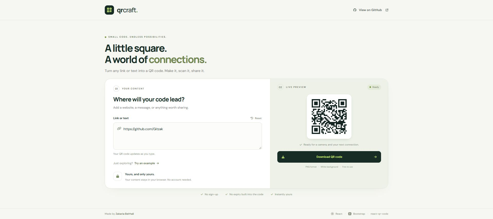

# QR Craft

A clean, single-page QR code generator built with **React**, **Bootstrap**, and **react-qr-code**. Turn a link or a short message into a QR code and download it as a PNG, directly in your browser.

**[Open the live demo](https://qr-code-react-gilt.vercel.app/)**



## Features

- **Live generation** — the QR code updates as you type.
- **PNG download** — crisp, integer-scaled modules on a white background, with a four-module quiet zone for scanning.
- **Simple controls** — try an example or reset your content in one click.
- **Private by design** — QR content is processed locally in your browser; it is not sent to a QR generation service.
- **Responsive layout** — a full-height desktop workspace and a stacked layout on smaller screens.
- **Accessible controls** — labelled inputs, visible keyboard focus, download states, and input feedback.

Static QR codes have no built-in expiry. A linked website can still change or become unavailable. The app limits content to 1,000 UTF-8 bytes to keep codes manageable.

## Tech stack

| Purpose | Library |
| --- | --- |
| Interface | React 18 |
| Layout and components | Bootstrap 5, React Bootstrap |
| QR generation | react-qr-code |
| Icons | Font Awesome |
| Development and build | Vite 5 |

No backend, database, or account is required. Fonts load from Google Fonts; system fonts are used as a fallback.

## Run locally

Use **Node.js 22.x** and npm.

```bash
git clone https://github.com/Gitzak/qr-code-react.git
cd qr-code-react
npm ci
npm run dev
```

## Commands

```bash
npm run dev      # Start the development server
npm run build    # Create the production build in dist/
npm run preview  # Preview the production build
npm run lint     # Check JavaScript and JSX
```

## How to use

1. Enter a website address or text in **Link or text**.
2. Check the live preview.
3. Select **Download QR code** to save your PNG.
4. Scan the exported image with your phone before sharing or printing it.

Use **Try an example** to explore, or **Reset** to clear the editor. Download is disabled while the input is empty or exceeds the content limit.

## Project structure

```text
src/
  App.jsx
  main.jsx
  styles.css
  components/
    Navigation/Navigation.jsx
    QrCodeCmp/QrCodeCmp.jsx
    Footer/Footer.jsx
public/
  favicon.svg
docs/
  screenshots/qr-craft-desktop.jpg
```

## Author

Built by [Zakaria Belrhali](https://github.com/Gitzak).

Ideas and improvements are welcome through [GitHub Issues](https://github.com/Gitzak/qr-code-react/issues).
